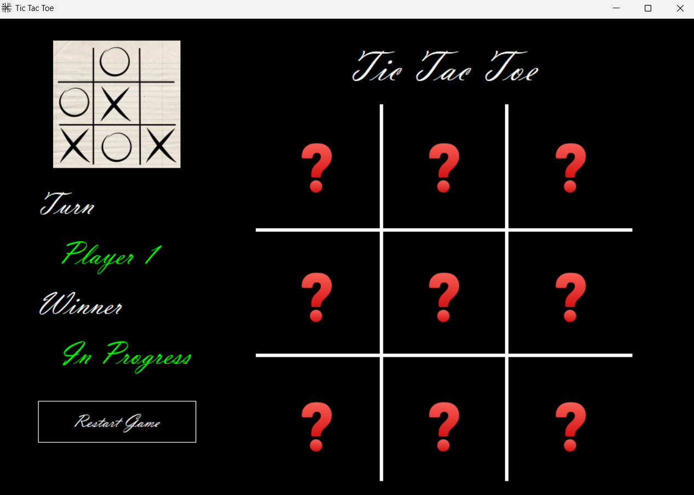

# ❌⭕ Tic Tac Toe WinForm

A classic two-player Tic Tac Toe game built as a Windows Forms desktop application in C# / .NET Framework 4.8.

Two players take turns on a 3×3 board. The first to line up three of their symbols — horizontally, vertically, or diagonally — wins. If all nine cells are filled with no winner, the game ends in a draw.

## 📖 Overview

`FrmTicTacToe` is a single-form game where:

- Player 1 plays with X

- Player 2 plays with O

- The current turn is displayed as "Player 1" or "Player 2"

- The Winner label shows "In Progress" until the game ends, then displays the winner's name or "Draw"

- Winning cells are highlighted in yellow

- A Restart Game button resets everything for a new match

The board grid is drawn manually on the form using GDI+ (`Graphics.DrawLine`) inside the form's `Paint` event — the cells themselves are flat `Button` controls with image backgrounds.

## ✨ Features

- 🎮 Two-player local gameplay

- 🖼️ Custom X / O / question-mark images on each cell

- 🟡 Winning line highlighted in yellow

- 🧠 Move counter to detect draws

- 🔒 Cells are disabled once the game ends

- ♻️ One-click restart with full state reset

- 🚫 Invalid move feedback (clicking an already-chosen cell shows an error dialog)

## 🖥️ Screenshot



## 📂 Project Structure

```bash
Tic-Tac-Toe/
│
├── FrmTicTacToe.cs            # Game logic (turn handling, win detection, reset)
├── FrmTicTacToe.Designer.cs   # Auto-generated UI layout & control definitions
├── FrmTicTacToe.resx          # Form resources
├── Program.cs                 # Application entry point
├── App.config                 # Runtime configuration (targets .NET Framework 4.8)
├── Tic-Tac-Toe.csproj         # Project file
├── Properties/
│   ├── AssemblyInfo.cs
│   ├── Resources.resx         # Embedded images (X, O, question mark)
│   └── Settings.settings
├── images/
│   ├── icons8-tic-tac-toe-100.ico
│   ├── O.png
│   ├── X.png
│   ├── question-mark-96.png
│   └── TicTacToe.jpg
├── .gitignore
└── README.md
```

## 🚀 Getting Started

### Requirements

- Windows OS

- Visual Studio 2019 / 2022 with the .NET desktop development workload

- .NET Framework 4.8 (as declared in App.config)

### Build & Run

1. Clone the repository:

   ```bash
       git clone https://github.com/Baraa-Mansour/Tic-Tac-Toe-WinForm.git
   ```

2. Open `Tic-Tac-Toe.csproj` (or the solution) in Visual Studio.

3. Press F5 (or Ctrl+F5) to build and run.

## 🕹️ How to Play

1. Launch the game. The board appears with question-mark icons in every cell.

2. Player 1 goes first (as X). Click any cell to place your mark.

3. The Turn label switches to Player 2; click a cell to place an O.

4. Continue alternating until:
   - A player gets three in a row (row, column, or diagonal) → that line turns yellow and the winner is shown.

   - All 9 cells are filled with no winner → Draw.

5. Click Restart Game to play again.

Clicking an already-occupied cell shows:

> ⚠️ Invalid Choice — "This Cell Already Chosen"

## 🧩 Code Highlights

### Key fields in FrmTicTacToe.cs

`Player1` / `Player2`: Constant strings identifying the two players

`MoveCounter`: Tracks how many moves have been made (used to detect a draw at 9)

`Winner`: Stores the result once the game ends

### Key methods

`FrmTicTacToe_Paint`: Draws the 3×3 grid lines using GDI+

`UpdateCellState(Button)`: Sets the clicked cell's image and tag to X or O based on the current player

`ChangePlayer()`: Switches the `lblPlayer` text between Player 1 and Player 2

`CellsEnabled(bool)`: Enables/disables all nine cell buttons

`ResetCell(Button)`: Restores a single cell to its starting state

`ResetCells()`: Resets all nine cells

`IsValidChoice(Button)`: Returns true only if the cell's tag is still `"?"`

`IsEqualLine(b1, b2, b3)`: Checks if three cells share the same non-empty tag; highlights them yellow if so

`IsWin()`: Tests all 8 possible winning lines

`IsGameEnd()`: Combines `IsWin()` and the move counter to decide if the game is over

`EndGame()`: Updates the winner label, disables cells

`btnCell_Click`: Main click handler for every board cell

`btnRestart_Click`: Resets the board and starts a new game

## Win detection

Eight lines are checked after every move:

```text
    Rows:      (1,2,3)  (4,5,6)  (7,8,9)
    Columns:   (1,4,7)  (2,5,8)  (3,6,9)
    Diagonals: (1,5,9)  (3,5,7)
```

Each cell stores its state in the `Tag` property (`"?",` "`X`", or "`O`"), which is how equality checks work.
